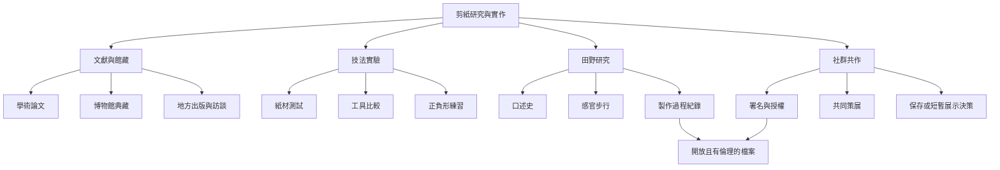

這份地圖把剪紙研究轉成可實際執行的路徑：先建立可靠的地區文獻，再進行材料與技法實驗；接著以訪談、觀察與影像記錄實作者和作品的使用情境；最後將檔案、保存、社群授權與共同創作納入延續方案。

概念連結：[[剪紙]]、[[紙本保存]]、[[非物質文化遺產]]、[[民藝]]。

可行動的靈感：[[在台灣社區共作一條季節剪紙旗串]]、[[把一次剪紙工作坊設計成感官步行記錄]]、[[用一張紙限制訓練構圖決策]]、[[建立跨文化剪紙比較圖譜]]、[[以口述史記錄地方剪紙知識]]、[[用剩紙建立低耗材剪紙工作台]]、[[讓節慶剪紙從裝飾回到共同敘事]]、[[創作時追蹤刀痕節奏與呼吸變化]]。

回到導讀：[[Papercutting]]
