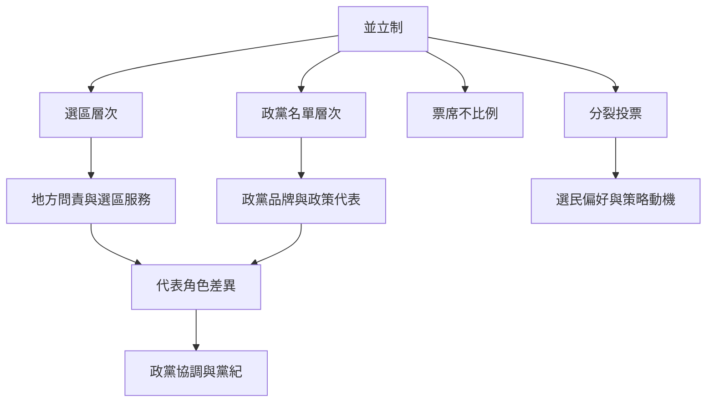

並立制不只是席次計算規則，也是一套分配地方代表、政黨代表與政黨競爭誘因的制度。它可能同時提供地方問責和政黨政策代表，但也可能形成代表類型差異、總體不比例與跨層次策略行為。

延伸概念：[[分裂投票]]、[[策略性投票]]、[[代表性]]、[[選區服務]]、[[有效政黨數]]、[[政黨門檻]]。

## 思與行
* 讓選制研究同時涵蓋選民、候選人、政黨與議會行為。
* 對代表性建立多維度評估，不把治理穩定或比例性當成唯一標準。

## 參考
* [[兩種選制疊加會同時產生地方代表與政黨代表]]
* [[分裂投票讓選民能分別表達地方與政黨偏好]]
* [[代表性必須分開衡量地理性描述性與政策性]]
