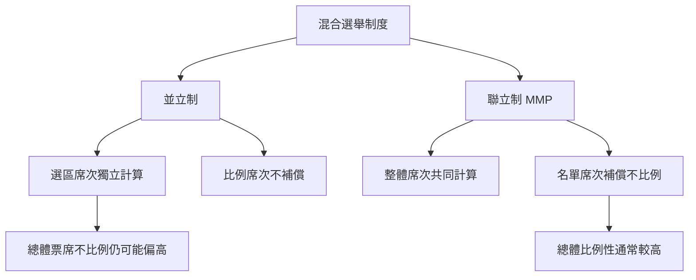

並立制與聯立制都把選區代表與比例代表放進同一個議會，但真正的分界在於席次之間是否補償。並立制的兩個席次層次獨立計算；聯立制則把選區席次納入比例席次計算。這一差異直接影響總體票席比例、政黨策略與小黨取得代表的機會。

延伸概念：[[並立制]]、[[聯立制]]、[[混合選舉制度]]、[[單一選區相對多數制]]、[[比例代表制]]、[[選票席次不比例]]。

## 思與行
* 使用同一份投票資料，模擬兩種席次公式，觀察政黨代表比例差異。
* 把門檻、名單席次比例與選區公式當作獨立變項，避免把「並立／聯立」當成唯一解釋。

## 參考
* [[並立制與聯立制必須依席次補償關係區分]]
* [[並立制的代表性優點與制度代價必須一起評估]]
* [[用同一組票數模擬並立制與聯立制的席次落差]]
