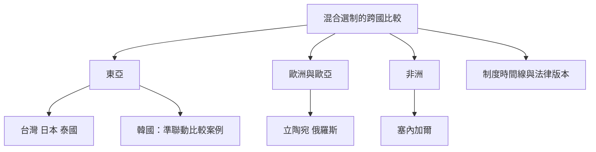

並立式混合選制在全球不同地區呈現多種具體組合。台灣、日本與泰國可觀察東亞的兩層次選舉設計；立陶宛提供兩輪選區制與全國名單比例制的組合；塞內加爾和俄羅斯則提醒研究者注意選制多次改制的歷史。韓國適合當作準聯動制的比較邊界案例，而不是純並立制的現行案例。

延伸概念：[[制度名稱必須附上議院與選舉年度才有意義]]、[[選制效果會受政體政黨與社會脈絡調節]]、[[混合選舉制度]]。

## 思與行
* 每個國別資料標註議院、選舉年度、席次數、公式與來源。
* 把「純並立案例」與「混合但有補償」案例分開，保持制度分類可查核。

## 參考
* [[日本眾議院以小選區與比例代表分開選出議員]]
* [[台灣立法委員選舉由三種席次組成]]
* [[泰國2026年選舉維持400席選區與100席政黨名單的雙票配置]]
* [[立陶宛以單一選區兩輪投票與全國比例名單組成混合制度]]
* [[塞內加爾的國會制度展示非洲並立制的歷史變動]]
* [[俄羅斯的並立制案例必須放回制度變遷脈絡]]
* [[墨西哥眾議院的比例席次具有補償功能因此不是純並立制]]
* [[混合制度不應只因同時有選區與名單席次就判成並立制]]
