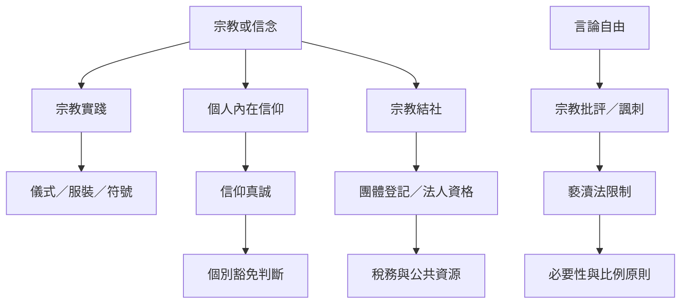

本圖把宗教分類、個人自由、組織登記、豁免與言論自由拆開，避免把「是否認定為宗教」當成所有法律問題的答案。

概念：[[宗教或信念]]、[[宗教自由]]、[[信仰真誠]]、[[褻瀆法]]、[[言論自由]]、[[世俗主義]]。

研究：[[Pastafarianism的真誠測試暴露宗教豁免制度的困難]]、[[國際人權法不容以冒犯宗教為由全面禁止批評]]、[[台灣宗教自由保障信仰不信仰與宗教結社]]。
