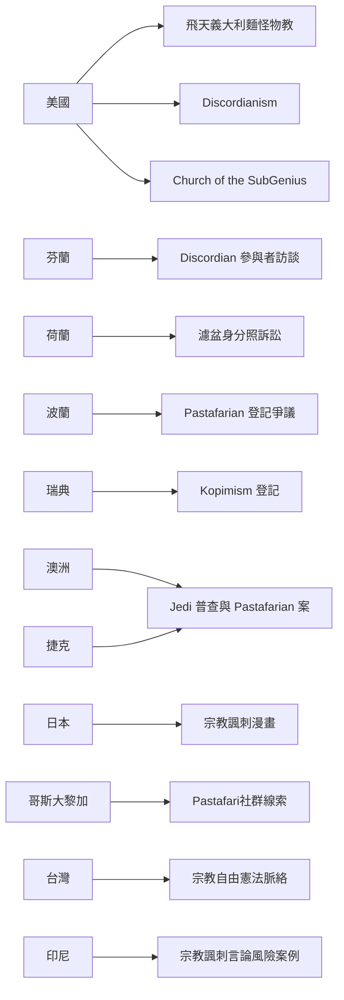

此圖以案例來源地與主要議題組織材料。地區分布不代表實際信徒規模；多數團體透過網路跨國流動。

案例資料：[[飛天義大利麵怪物教從智能設計爭議誕生]]、[[歐洲人權法院拒絕將Pastafarianism視為受公約保障的宗教]]、[[波蘭Pastafarianism登記爭議顯示行政機關如何劃定宗教]]、[[瑞典Kopimism把資訊複製轉化為神聖實踐]]、[[台灣宗教自由保障信仰不信仰與宗教結社]]、[[印尼諷刺言論案件提醒宗教幽默的風險取決於地方脈絡]]。

補充材料：[[日本宗教漫畫顯示宗教戲仿也可能只是藝術表達]]、[[哥斯大黎加Pastafari社群顯示拉丁美洲資料仍需更多田野研究]]。

解讀限制：現有全球文獻集中在北美、歐洲與澳洲。台灣及其他亞洲、非洲、拉丁美洲案例仍需在地語言研究，不能以空白推論不存在。
