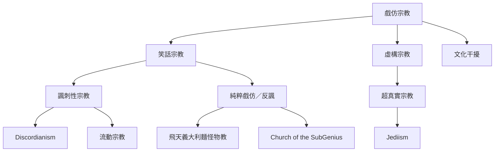

本圖整理從「笑話宗教」到「超真實宗教」的概念光譜，提醒分類是分析工具而非排他框架。某個團體可能同時具有諷刺、身份、儀式與社會行動的面向。

概念定義參見[[戲仿宗教]]、[[笑話宗教]]、[[諷刺性宗教]]、[[超真實宗教]]、[[虛構宗教]]、[[文化干擾]]。

案例與研究：[[戲仿宗教是同時認真與玩笑的文化形式]]、[[芬蘭Discordian訪談顯示荒誕可以成為生活世界]]、[[美國SubGenius以宗教戲仿介入文化戰爭]]、[[絕地教人口普查反映流行文化與宗教認同交疊]]。
