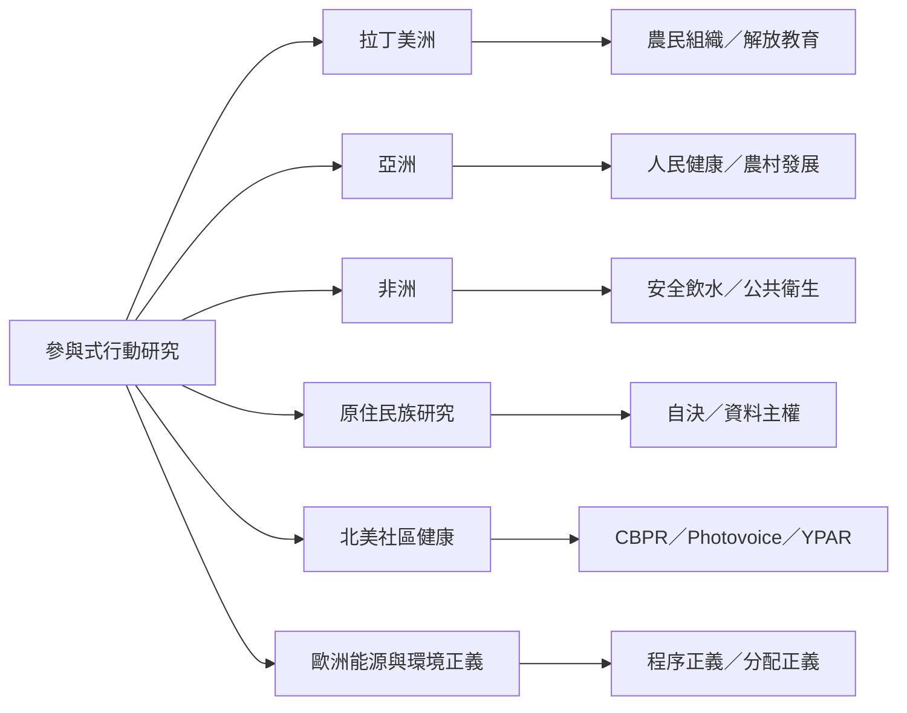

PAR 在不同地區與領域形成多樣實踐。這張地圖以場域為索引，提醒讀者比較地方脈絡、政治條件與組織能力，而不是複製一套工具。

案例筆記：[[拉丁美洲的參與式行動研究將知識生產連結農民組織與社會轉化]]、[[亞洲參與式研究文集呈現農村組織與反殖民知識政治]]、[[南非安全飲水研究由社區提出問題並共同執行行動計畫]]、[[澳洲原住民族參與式行動研究將去殖民與社會情緒福祉連結]]、[[世界衛生組織整理十六個社群參與結核病防治案例]]、[[英國布里斯托社區能源研究顯示主動參與可連結能源正義]]、[[臺灣大學社會責任實踐揭示大學與地方合作的角色張力]]。

## 思與行
跨國比較時，至少記錄：問題如何形成、社群如何組織、資源來自何處、研究成果由誰控制、行動是否改變制度。
