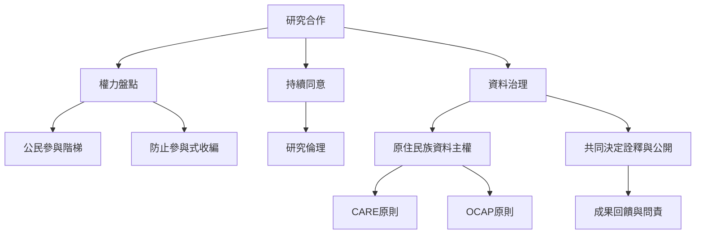

參與式研究的倫理核心不是單一的同意書，而是持續處理權力、風險、資料控制、代表性與利益分配。對原住民族及其他易受傷害的群體，更須依社群自身規範決定研究是否適當。

相關概念：[[公民參與階梯的概念定義]]、[[參與式收編的概念定義]]、[[研究倫理的概念定義]]、[[原住民族資料主權的概念定義]]、[[CARE資料原則的概念定義]]、[[OCAP原則的概念定義]]。

## 思與行
在研究計畫核准或募款之前，就先與合作社群共同完成資料治理及權力協議；不要等到成果要發表時才討論控制權。
