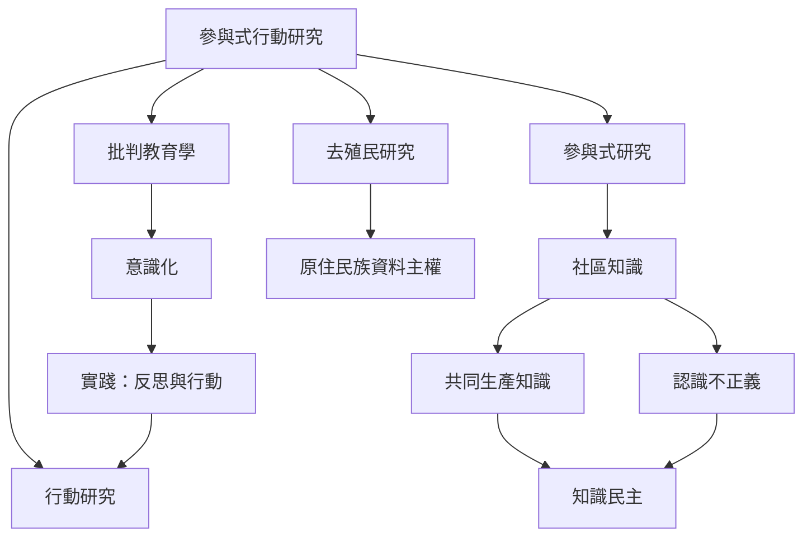

這張地圖把 PAR 放回多地思想傳統：行動研究、解放教育、拉丁美洲社會轉化、去殖民研究與知識民主。其目的不是建立唯一正統，而是辨認思想交會處與歷史差異。

相關概念：[[參與式行動研究的概念定義]]、[[行動研究的概念定義]]、[[批判教育學的概念定義]]、[[意識化的概念定義]]、[[實踐（反思與行動）的概念定義]]、[[認識不正義的概念定義]]、[[共同生產知識的概念定義]]、[[社區知識的概念定義]]、[[原住民族資料主權的概念定義]]。

## 思與行
以「誰能生產有效知識」為主線閱讀，並對照拉丁美洲、亞洲與原住民族研究脈絡，避免把不同歷史傳統合併成單一方法。
