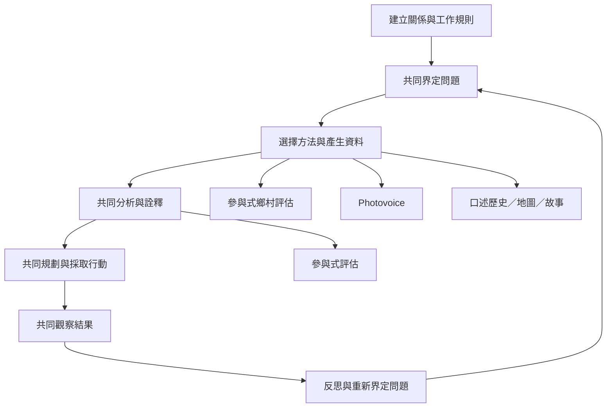

這張地圖呈現 PAR 如何將關係建立、問題形成、資料生成、共同分析與行動連成反覆循環。方法工具應由社群問題和安全條件決定，而非由研究者預先選好。

相關概念：[[反思行動循環的概念定義]]、[[參與式鄉村評估的概念定義]]、[[Photovoice影像參與法的概念定義]]、[[參與式評估的概念定義]]、[[青年參與式行動研究的概念定義]]。

## 思與行
把這張圖轉成實際專案流程時，應在每個節點標註「誰決定、誰執行、誰詮釋、誰能拒絕」，並允許社群改變順序或刪除不合宜的步驟。
