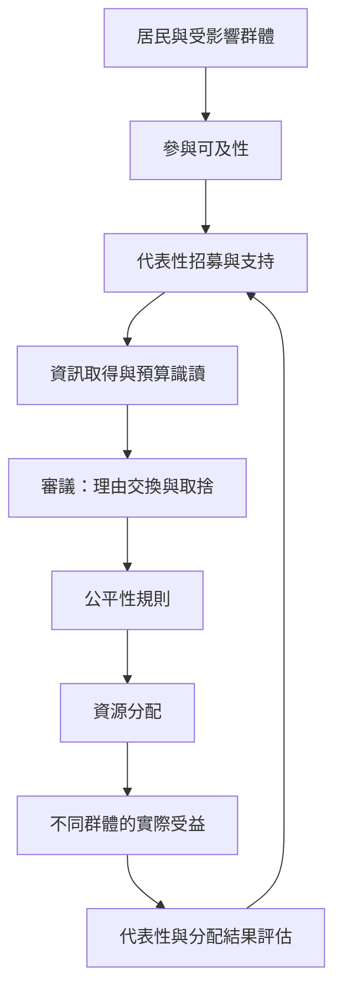

參與式預算的公平性不能只看每個人是否有投票權。提案與審議的參與組成、參與成本、社區資源條件、需求權重及實際受益者，都會影響公共資源最後流向。審議機制可協助居民理解取捨，但需要搭配主動招募與公平分配設計。

**核心概念**：[[參與者的社會代表性必須被主動設計而不能假設]]、[[公民參與成本會把時間教育與照顧責任轉成隱性門檻]]、[[數位投票應與實體參與並行以避免新型排除]]、[[分配正義需要把需求程度納入投票規則]]、[[民主審議能補足多數決無法呈現的理由交換]]。

**國際材料**：[[2026歐洲政策研究將弱勢居民參與視為制度設計核心]]、[[紐約市參與式預算的選民組成未必自然代表弱勢群體]]、[[美國十個社區研究顯示公平導向設計能支持弱勢群體]]、[[墨西哥城的參與式預算需要檢查地方代表與社區資源不均]]。

[[Participatory_budgeting]]
