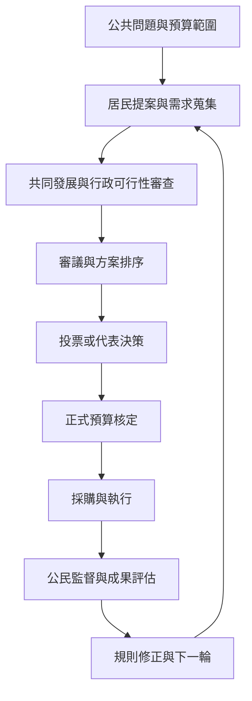

參與式預算不是投票活動，而是跨越問題界定、提案發展、審議、預算決定、執行與監督的制度生命週期。閱讀時應逐階段詢問：誰設定議程、誰能修改方案、誰作最後決定、誰負責執行，以及居民如何要求回應。

**關鍵閱讀**：[[參與式預算的核心不是諮詢而是公民對一部分公共資源具備影響力]]、[[參與式預算的決策權必須被寫進制度規則]]、[[預算參與應同時涵蓋資源優先序與提案細節]]、[[行政可行性審查必須公開避免官僚把關變成政治控制]]、[[公民提案的執行率是制度可信度的核心指標]]、[[參與式預算需要跨年度追蹤才能形成公共問責]]、[[公民監督應延伸到採購施工與成果驗收]]。

**資料來源**：[[OECD建議只有存在真實決策空間時才啟動參與程序]]、[[紐約市人民的錢以兩年週期連接提案投票和執行]]、[[台北市以專案管理推動公民提案仍面臨官僚裁量問題]]。

[[Participatory_budgeting]]
