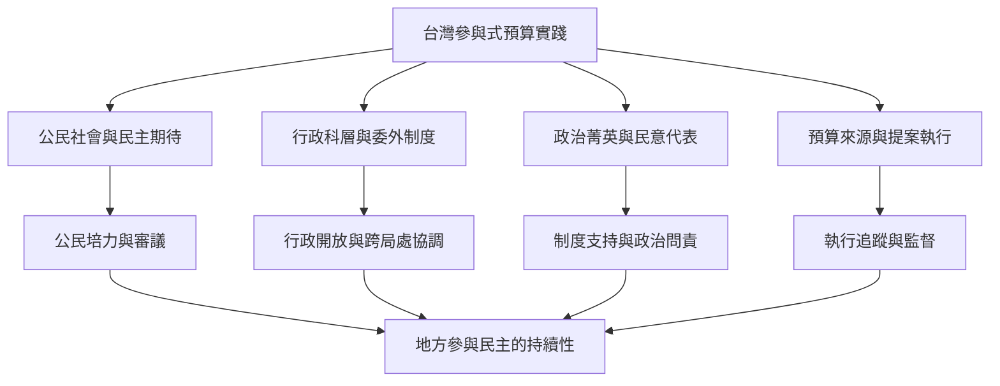

台灣自2015年前後出現參與式預算推廣熱潮，地方制度同時受到公民社會期待、行政科層習慣、民代態度、外包治理及執行預算等因素影響。台北、台中及跨縣市研究顯示，居民能力培養與政府行政改變必須同時進行；若只有前端動員而缺乏後端執行，容易傷害信任。

**研究入口**：[[台中參與式預算的制度化需要行政開放與公共教育]]、[[台中參與式預算的賦權效果受外包與執行預算限制]]、[[台灣先驅計畫的184份訪談揭示參與式預算各階段的不滿]]、[[台北市以專案管理推動公民提案仍面臨官僚裁量問題]]。

**可延伸方向**：[[以微型年度預算練習建立可持續的社區共治循環]]、[[建立提案狀態儀表板讓公共承諾一路追蹤到驗收]]、[[把參與式預算與公民監督公共採購串成一個閉環]]。

[[Participatory_budgeting]]
