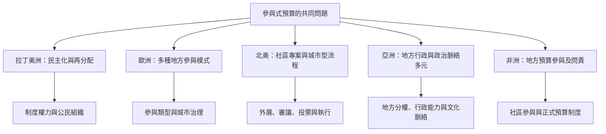

參與式預算的跨國擴散不是複製同一套程序，而是把公民權力、地方財政與既有參與制度重新組合。比較案例時，先辨認制度的層級、預算池、參與者、決定方式與執行機關，再判斷它究竟是預算諮詢、社區基金、專案型投票或更完整的地方分權規劃。

**拉丁美洲**：[[波多阿雷格雷的參與式預算把貧困社區帶入公共投資決策]]、[[巴西多城市比較顯示參與式預算成敗取決於權力授予與公民組織]]、[[墨西哥城的參與式預算需要檢查地方代表與社區資源不均]]、[[喀拉拉邦人民計畫以地方分權把預算權交給地方政府]]。

**歐洲與北美**：[[歐洲參與式預算可分成六種制度理想型]]、[[2026歐洲政策研究將弱勢居民參與視為制度設計核心]]、[[巴黎2025年公民預算顯示實體投票仍不可忽視]]、[[紐約市人民的錢以兩年週期連接提案投票和執行]]。

**亞洲與非洲**：[[亞洲二十五年回顧指出參與式預算必須依政治脈絡調整]]、[[首爾以市民委員會與地域會議連接提案和預算編製]]、[[台中參與式預算的制度化需要行政開放與公共教育]]、[[南非eThekwini案例呈現地方政府預算參與的協商挑戰]]。

[[Participatory_budgeting]]
