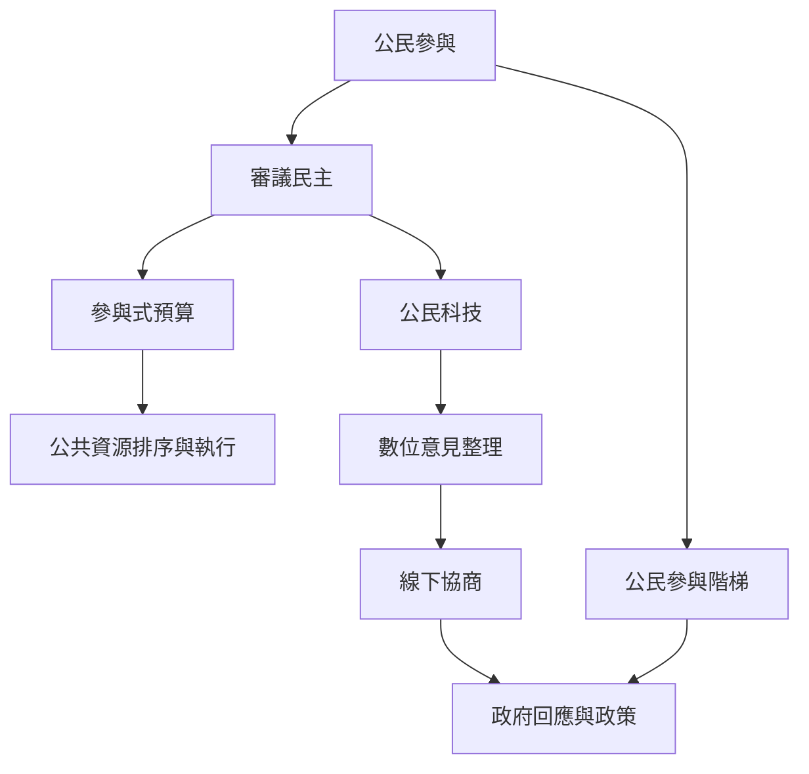

本地圖聚焦文化參與如何跨入公共決策。從公民參與階梯檢視權力深度，再以參與式預算、公民科技與審議民主連結討論、資源與制度。台灣 vTaiwan 與巴西波多阿雷格里提供不同制度型態的比較案例。

**延伸閱讀**：[[公民參與]]、[[公民參與階梯]]、[[參與式預算]]、[[審議民主]]、[[公民科技]]、[[參與的關鍵不是發言次數而是影響決策的權力]]、[[參與式預算把公共討論連結到可追蹤的資源分配]]、[[數位討論工具應該輔助而不是取代公共審議]]
