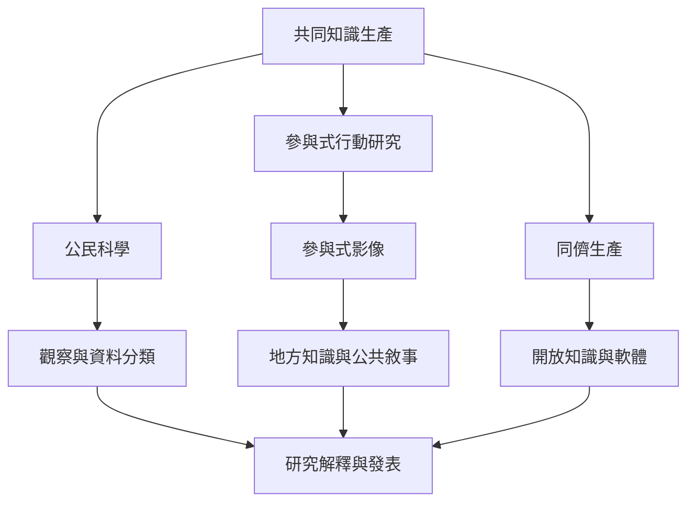

本地圖整理參與者如何共同生產研究、資料、影像與知識。公民科學、參與式行動研究、參與式影像與同儕生產各自有不同的研究權限與成果所有權，必須區分貢獻任務與研究決策。

**延伸閱讀**：[[公民科學]]、[[參與式行動研究]]、[[參與式影像]]、[[同儕生產]]、[[青年應參與定義教育問題而不只是接受教育]]、[[參與式影像能讓地方知識進入公共議題]]、[[同儕生產讓分散的專長可以共同維護公共知識]]
