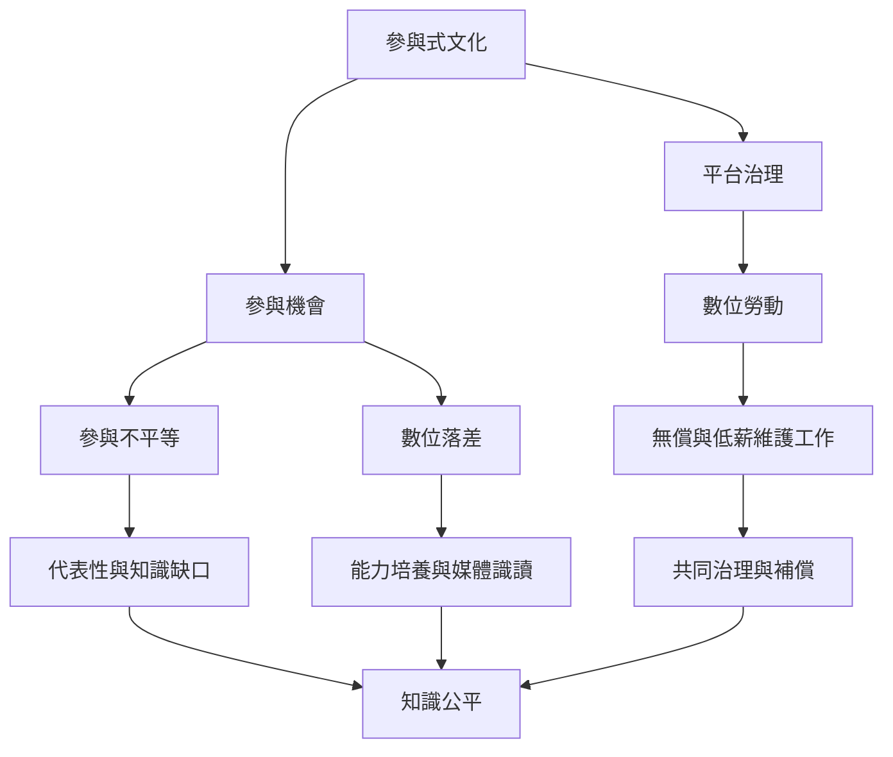

本地圖把參與的理想與其結構限制放在一起：接取不平等、貢獻集中、平台擷取價值，以及核心成員承擔維護勞動。評估參與式文化時，應追問誰能進入、誰能影響規則、誰獲得收益與誰承擔成本。

**延伸閱讀**：[[數位落差]]、[[參與不平等]]、[[數位勞動]]、[[媒體識讀]]、[[文化民主]]、[[可見度增加不代表權力關係已經改變]]、[[平台可以把使用者的創作與互動轉化為商業價值]]、[[分散式參與仍依賴看不見的協調與照顧工作]]
