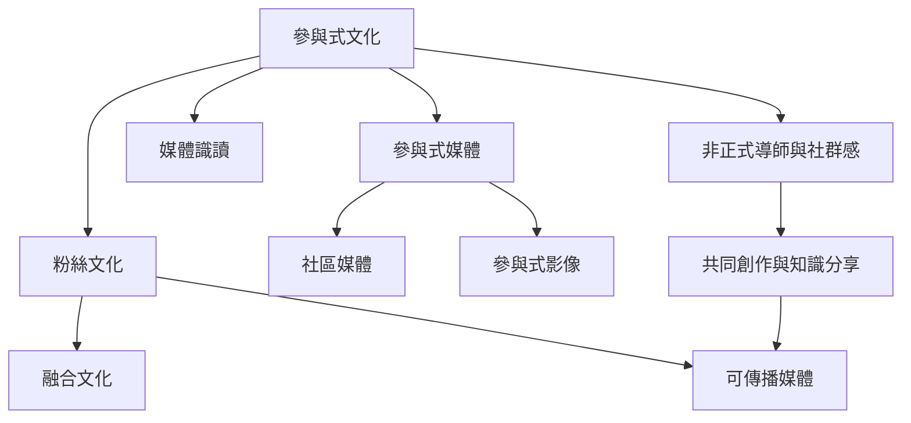

本地圖整理參與式文化如何從受眾的再詮釋、社群分享與非正式學習，發展為跨媒體的共同創作。重點不在平台功能，而在低門檻、互助、歸屬與內容流通。可搭配[[參與式文化是由創作分享與社會連結構成的共同生活]]、[[共同想像讓文化社群有機會轉化為公共行動]]閱讀。

**延伸閱讀**：[[參與式文化]]、[[粉絲文化]]、[[融合文化]]、[[可傳播媒體]]、[[參與式媒體]]、[[社區媒體]]、[[參與式影像]]、[[媒體識讀]]、[[參與式文化是由創作分享與社會連結構成的共同生活]]、[[共同想像讓文化社群有機會轉化為公共行動]]
