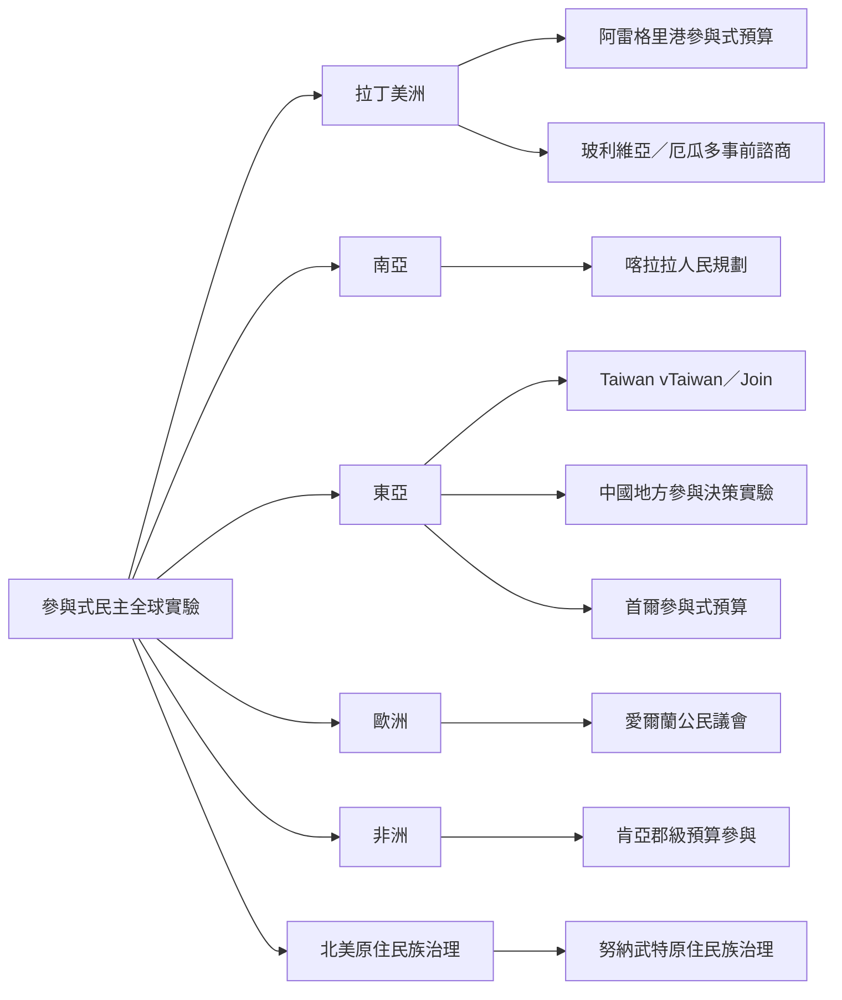

全球案例顯示參與式民主不是一種可直接複製的制度模板。拉丁美洲以參與式預算和原住民族政治參與見長；南亞展示地方分權與村民規劃；東亞包含數位審議、地方預算與威權場域實驗；歐洲發展公民議會；非洲案例提醒制度規則與地方政治脈絡的重要性；北美原住民族治理則拓展了民主與自治的想像。

案例文獻：[[波多阿雷格里參與式預算將公民參與帶入公共資源分配]]、[[參與式預算全球擴散會隨地方制度而改變原型]]、[[喀拉拉人民規劃運動展示分權資源與公民參與如何結合]]、[[台灣vTaiwan結合線上意見聚合與線下協作審議]]、[[台灣Join平台影響政策的能力取決於政策領域與政府回應]]、[[愛爾蘭公民議會逐步制度化憲政審議]]、[[肯亞預算參與成效取決於制度規則與地方政治條件]]、[[玻利維亞與厄瓜多原住民族事前諮商制度的規則與實踐出現落差]]、[[原住民族治理創新能延伸民主但仍面臨制度障礙]]、[[中國大規模參與式決策實驗提供威權場域公民參與的因果證據]]。
