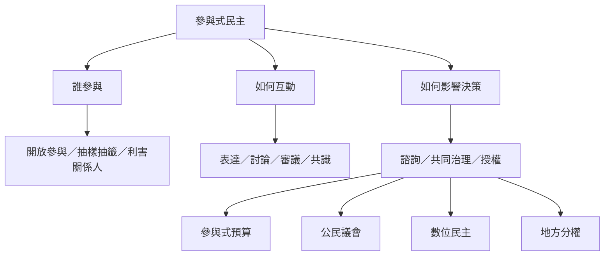

參與式民主不是單一制度，而是把公民納入公共權力運作的不同安排。理解制度時，可先問三件事：誰能參與、如何互動、參與結果如何接上決策。這三個問題可以用民主立方體串起參與式預算、公民議會、數位諮詢與地方共同治理。

核心概念：[[參與式民主]]、[[民主創新]]、[[參與階梯]]、[[賦權式參與治理]]、[[共同治理]]、[[地方分權]]、[[輔助性原則]]、[[直接民主]]、[[代議民主]]、[[審議式民主]]。

分析筆記：[[參與式民主不是增加發言次數而是重新分配決策權]]、[[參與制度的民主品質取決於誰參與如何互動影響何種決策]]、[[多元機制組合可避免單一模式承擔全部民主任務]]、[[權力下放必須同時轉移財政權與行政能力]]。

研究入口：[[參與設計可沿參與者選擇互動方式與政策連結三軸分析]]、[[喀拉拉人民規劃運動展示分權資源與公民參與如何結合]]、[[波多阿雷格里參與式預算將公民參與帶入公共資源分配]]、[[OECD將公民參與流程視為可設計與評估的制度工程]]。
