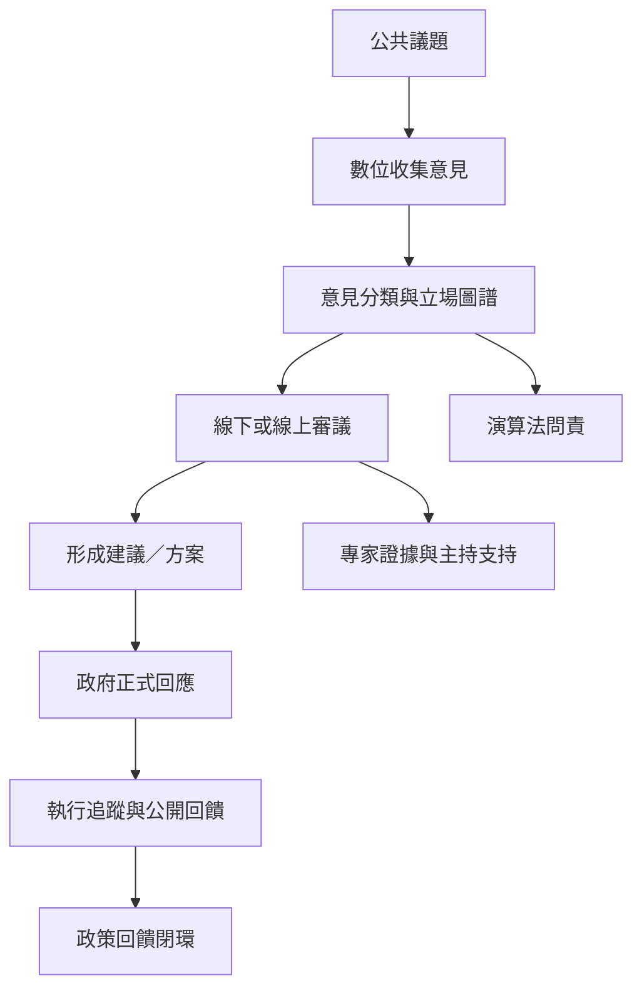

數位科技能降低資訊與參與成本，也可能帶來新的平台權力、演算法偏誤與數位排除。審議工具則協助公民從偏好表達走向知情討論。制度設計的關鍵，是讓平台服務於公共討論，並把討論連接到可問責的決策者。

概念：[[數位民主]]、[[審議式民主]]、[[公民議會]]、[[審議式民調]]、[[公民陪審團]]、[[抽樣抽籤]]、[[演算法問責]]、[[政策回饋閉環]]、[[公共領域]]。

核心筆記：[[線上平台能擴大聲音卻不自動消除權力不平等]]、[[專家知識應支援公共判斷而非壟斷決策]]、[[AI可以整理提案但公共價值排序必須接受民主監督]]、[[公民議會補足選舉代表制但不應取代普遍參與]]。

案例：[[台灣vTaiwan結合線上意見聚合與線下協作審議]]、[[台灣Join平台影響政策的能力取決於政策領域與政府回應]]、[[愛爾蘭公民議會逐步制度化憲政審議]]、[[首爾參與式預算中的AI可能減輕行政負擔但不能代替審議]]。
