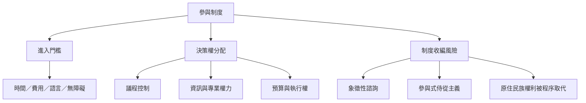

參與程序的外觀可能平等，實際參與能力卻受到時間、收入、教育、語言、照顧責任、身心障礙、政治組織與技術能力影響。參與式民主必須同時處理「誰有資格進入」與「誰能影響結果」，並辨識參與被收編或用來合法化既定政策的風險。

相關概念：[[公民社會]]、[[社會資本]]、[[政治效能感]]、[[原住民族自由事前知情同意]]、[[去殖民化]]、[[參與階梯]]。

核心筆記：[[社會不平等會轉化為參與機會的不平等]]、[[抽籤代表性需要資源支持與透明方法]]、[[參與需要被制度化但也要保留公民社會自主]]、[[參與可以成為治理合法化甚至收編手段]]、[[原住民族諮商不能取代社群的自由事前知情同意]]、[[參與式民主應容納多元自治與集體權利]]。

案例：[[喀拉拉人民規劃運動的歷史政治脈絡揭示參與制度的矛盾]]、[[肯亞預算參與成效取決於制度規則與地方政治條件]]、[[玻利維亞與厄瓜多原住民族事前諮商制度的規則與實踐出現落差]]。
