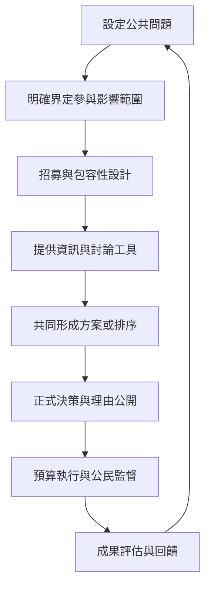

一套參與制度必須能回答：參與者是否多元、資訊是否充分、討論是否公平、決定是否有影響力、政府是否落實、制度是否提升公共能力，以及成本是否合理。若未事先定義決策權與回應責任，單純蒐集意見很難形成可檢驗的民主成果。

評估概念：[[政策回饋閉環]]、[[公共財政]]、[[公民監督]]、[[政治效能感]]、[[參與階梯]]。

永久筆記：[[參與成果能否落地決定參與者是否持續投入]]、[[民主品質應同時評估政策結果與公民學習]]、[[公民注意力有限因此參與頻度應與議題重要性相稱]]、[[參與制度必須事前說明影響範圍並事後交代結果]]、[[多元機制組合可避免單一模式承擔全部民主任務]]。

可實作的延伸：[[把地方生活共同體設計成小尺度公共決策實驗室]]、[[為公共討論建立提案審議決策回應的完整閉環]]、[[用參與者旅程檢查哪些人被制度排除]]、[[建立公民提案政策影響追蹤公開儀表板]]、[[把參與成果寫成可檢驗的地方民主實驗]]。
