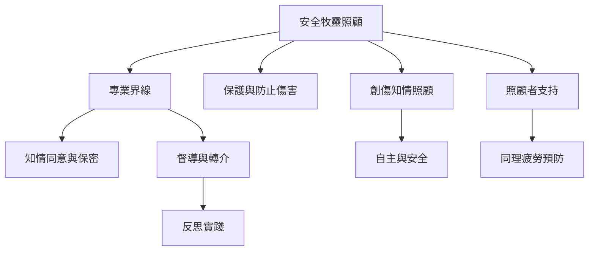

照顧關係發生在脆弱與權力不對稱之中，因此倫理不只是照顧者個人的好品格，而是制度安排。保密、知情同意、界線、督導、轉介、申訴與反歧視機制共同構成安全服務。照顧者也需要休息、支持與可以承認脆弱的團隊文化。

## 延伸閱讀
* 概念：[[term/專業界線]]、[[term/保護與防止傷害]]、[[term/創傷知情照顧]]、[[term/反思實踐]]、[[term/同理疲勞]]。
* 核心論點：[[note/專業界線與督導是牧靈照顧安全的基礎設施]]、[[note/牧靈支持必須讓LGBTQ當事人免於羞辱與身份矯正]]、[[note/災難中的牧者也需要被照顧]]、[[note/照顧者自我照顧不能取代制度性支持]]。
* 行動延伸：[[idea/用三層轉介地圖辨識陪伴服務的能力邊界]]、[[idea/讓災難應變計畫包含照顧者的輪休與互助]]。
