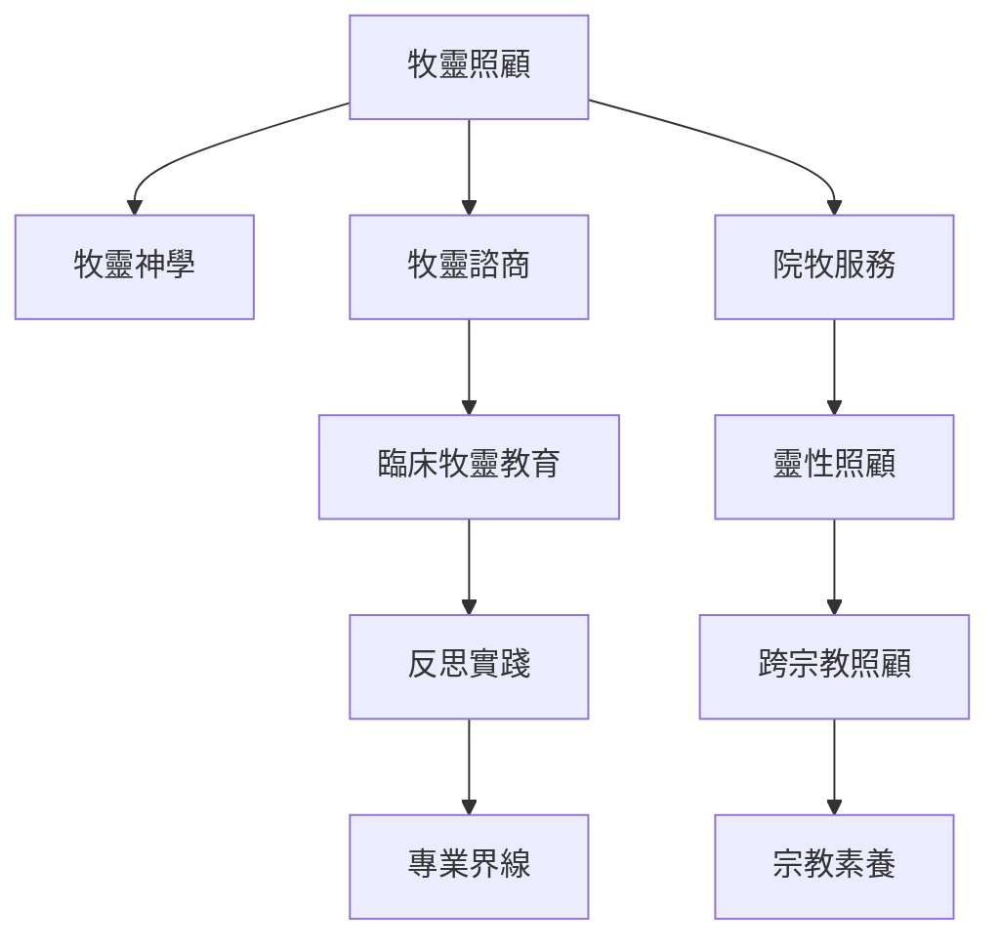

本圖從歷史概念、專業角色與反思教育理解牧靈照顧。牧靈照顧起源於基督宗教牧養傳統，但現代服務已延伸到醫療、監所、教育、災難與社區場域；院牧與靈性照顧擴大了跨信仰和非宗教服務的可能。臨床牧靈教育則透過案例、督導與反思，協助照顧者持續校準角色。

## 延伸閱讀
* 概念：[[term/牧靈照顧]]、[[term/牧靈神學]]、[[term/牧靈諮商]]、[[term/院牧服務]]、[[term/臨床牧靈教育]]、[[term/靈性照顧]]、[[term/跨宗教照顧]]。
* 核心論點：[[note/牧靈照顧必須從受照顧者的生活世界開始]]、[[note/牧靈陪伴不是替人解釋痛苦而是共同承受不確定]]、[[note/臨床牧靈教育把照顧經驗轉化為受督導的反思學習]]。
* 靈感實踐：[[idea/建立照顧者學習圈以反思案例取代英雄式助人]]。
