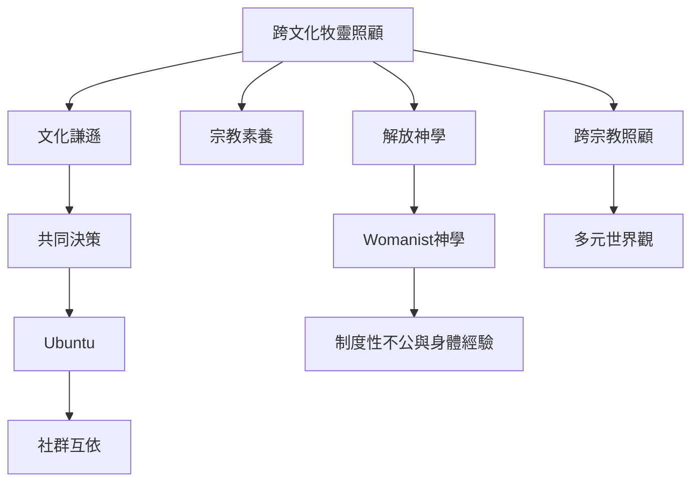

本圖聚焦牧靈照顧如何回應文化差異、殖民歷史、社群關係與結構性不平等。不同地區的照顧觀不可被簡化成單一全球模型；Ubuntu、非洲牧靈神學、日本 kokoro、台灣安寧實踐、Womanist 神學和跨宗教團隊研究，各自提供不同的問題意識。

## 延伸閱讀
* 概念：[[term/Ubuntu]]、[[term/文化謙遜]]、[[term/宗教素養]]、[[term/跨宗教照顧]]、[[term/解放神學]]、[[term/Womanist神學]]。
* 核心論點：[[note/非洲牧靈照顧強調關係參與與共同決策]]、[[note/Ubuntu關懷若不檢查性別分工便可能複製不平等]]、[[note/牧靈照顧必須同時回應個人痛苦與制度性不公]]、[[note/東亞靈性照顧應保留在地語彙與世界觀差異]]。
* 行動延伸：[[idea/以Ubuntu與互賴學共同設計社區照顧協作]]、[[idea/讓受照顧者共同制定服務品質指標]]。
