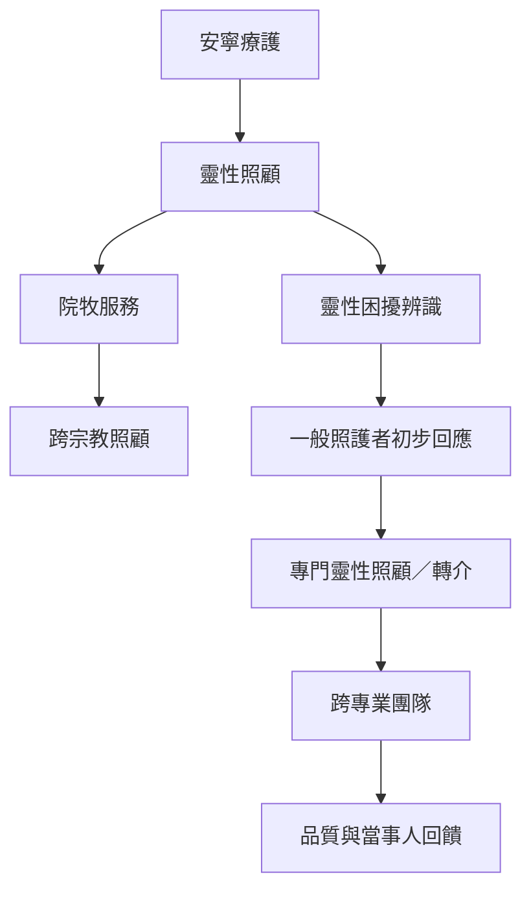

這張地圖從安寧療護與院牧服務出發，整理靈性評估、專業分工、跨宗教轉介和品質衡量。一般照護人員可辨識基本需要，但複雜困擾需要適當訓練與轉介；任何評估都必須尊重病人拒絕服務的權利。

## 延伸閱讀
* 概念：[[term/安寧療護]]、[[term/靈性照顧]]、[[term/靈性困擾]]、[[term/院牧服務]]、[[term/跨宗教照顧]]。
* 核心論點：[[note/安寧療護的靈性評估必須同時保障拒絕的權利]]、[[note/牧靈照顧需要與醫療心理及社會服務清楚協作]]、[[note/靈性照顧的普遍可近用性不等於成效證據已充分]]。
* 行動延伸：[[idea/把靈性照顧整合進安寧團隊但保留專業分工]]、[[idea/建立不假定信仰的開放式陪伴邀請]]。
