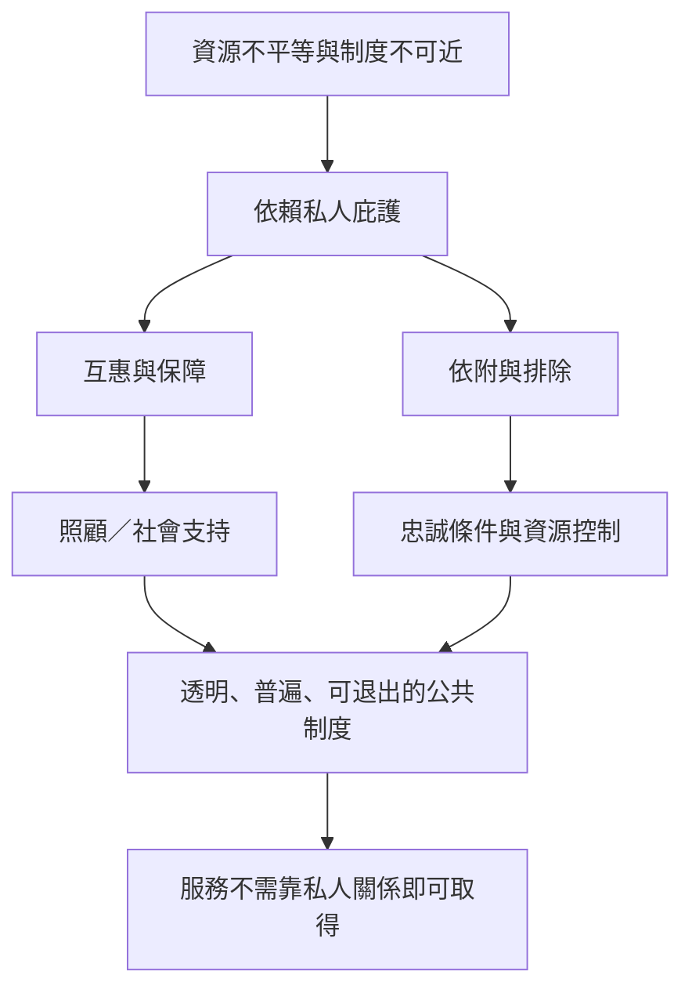

這張地圖將家產制研究連到公共倫理與制度設計。私人庇護可能提供實際保障，卻也可能讓基本權益取決於個人忠誠。公共制度的挑戰不是消滅社會互惠，而是使互助關係與普遍公民權相容：透明分配、可退出、可申訴、非歧視與官僚責任。

## 關係圖

## 參考
* [[互惠既可能提供保障也可能形成依附]]
* [[家產制概念必須和貪腐及裙帶關係分開]]
* [[社區互助制度應讓受助者不必以忠誠償還資源]]
* [[設計透明的公共服務可以降低個人庇護的必要性]]
* [[用公共資源流程圖辨識私人化權力的進入點]]
* 本書導讀：[[Patrimonialism]]
