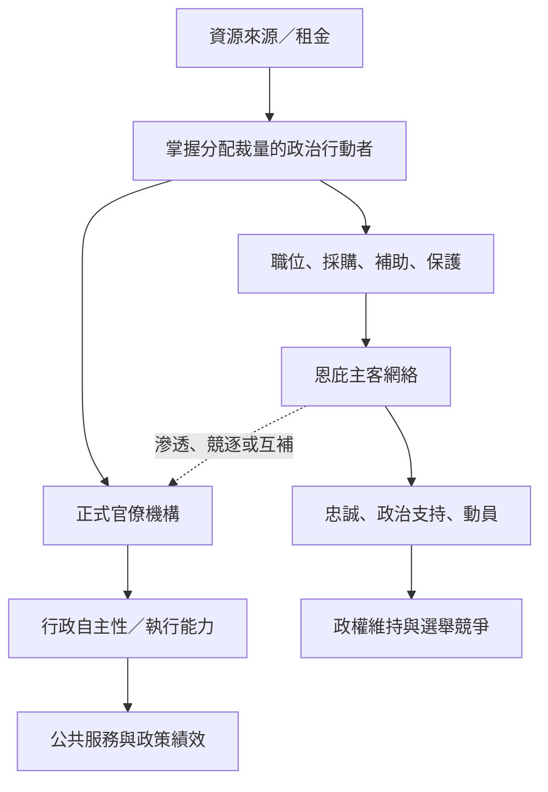

此地圖把抽象概念拆成可追蹤的機制：公共職務如何被私人化、恩庇如何交換忠誠、租金如何供應網絡、客戶主義如何介入選舉，以及官僚自主性與國家能力如何受到影響。這些機制不一定同時出現，也不必然導致相同結果。

## 關係圖

## 參考
* [[官職私人化令公共資源變成統治者的可支配財產]]
* [[恩庇網絡以不對稱互惠交換維繫忠誠]]
* [[租金來源影響庇護網絡穩定性]]
* [[民主選舉可能擴大或重組恩庇分配]]
* [[國家能力可與政治私人化同時存在]]
* [[互惠既可能提供保障也可能形成依附]]
* [[庇護主客關係]]
* [[租金國家]]
* [[國家俘獲]]
* [[官僚自主性]]
* 本書導讀：[[Patrimonialism]]
