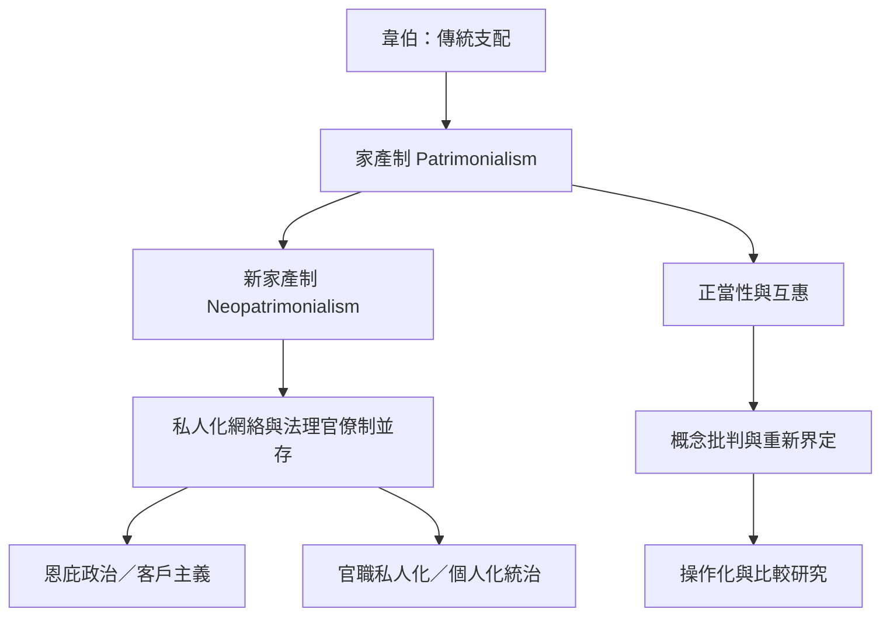

這張地圖整理家產制從韋伯的傳統支配理想型，到艾森斯塔特的新家產制概念，再到當代對概念界線、正當性、官僚制度與私人網絡的爭論。閱讀時先分清「權威的正當性」、「行政組織方式」與「資源交換機制」三個層次。

## 關係圖

## 參考
* [[家產制]]
* [[新家產制]]
* [[傳統支配]]
* [[法理型支配]]
* [[恩庇政治]]
* [[政治客戶主義]]
* [[個人化統治]]
* [[家產制描述權威如何被正當化而不等同於貪腐]]
* [[新家產制描述私人關係滲入正式制度]]
* [[應區分恩庇政治客戶主義和家產制層級]]
* 本書導讀：[[Patrimonialism]]
