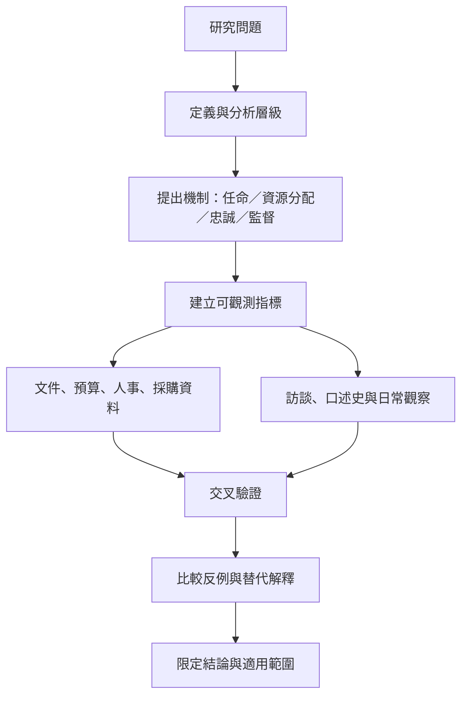

此地圖提供研究設計路徑：先界定概念與分析層級，再提出具體機制，選擇指標與資料來源，並且考慮反例、替代解釋及歷史脈絡。新家產制不應只靠印象判斷；須有足夠證據說明私人網絡如何系統性影響正式制度。

## 關係圖

## 參考
* [[艾德曼與恩格爾主張新家產制必須先被清楚界定]]
* [[以具體可觀測指標研究而不是貼標籤]]
* [[非正式制度由日常行動者共同再製]]
* [[研究家產制時應訪談資源鏈上的不同位置]]
* [[建立一份防止概念濫用的比較研究檢核表]]
* 本書導讀：[[Patrimonialism]]
