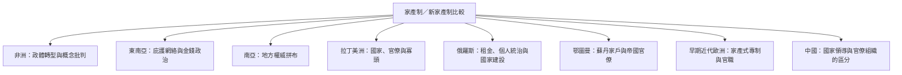

家產制不是某一大陸的專屬特徵。不同地區的學術研究關注不同歷史條件：非洲的後殖民國家建構與民主轉型、東南亞的地方庇護網絡與選舉政治、南亞的拼布式國家、拉丁美洲的官僚—寡頭關係、俄羅斯的政權與國家建設張力、鄂圖曼與早期近代歐洲的家戶行政與官職制度。比較時應保留制度差異。

## 關係圖

## 參考
* [[非洲案例的比較視角與概念爭論]]
* [[東南亞案例呈現選舉政治與庇護網絡的交織]]
* [[南亞案例顯示國家權威的地方差異會重組恩庇政治]]
* [[菲律賓案例顯示家產式國家可與寡頭資本互相強化]]
* [[俄羅斯案例呈現政權穩定與國家建設之間的張力]]
* [[鄂圖曼案例顯示家戶隱喻與帝國官僚制可以並存]]
* [[中國案例提醒研究者區分政治領導權威與官僚組織]]
* [[歐洲早期近代國家也曾出現官職與公共權力私有化]]
* 本書導讀：[[Patrimonialism]]
