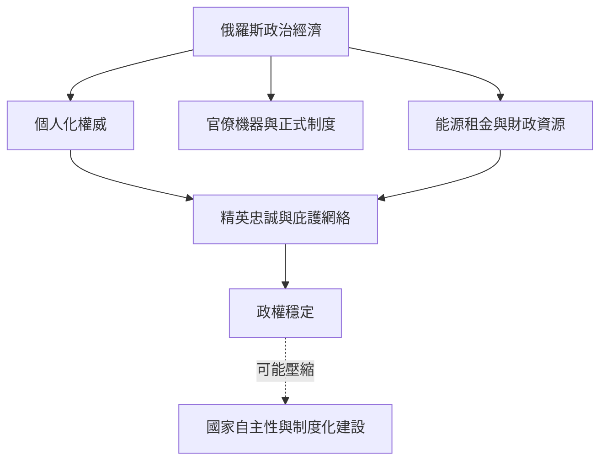

俄羅斯研究常把家產式私人化關係、官僚機器、市場經濟與資源租金放在同一分析框架中。此案例的重點不是簡單將俄羅斯定性為新家產制，而是追蹤政權維持、精英聯盟、行政自主性與財產權制度如何互相制約。

## 關係圖

## 參考
* [[羅賓遜以俄羅斯案例說明個人化政治與非人格制度互相衝突]]
* [[瓦西列娃迪內斯以企業訪談分析俄羅斯統計家產資本主義]]
* [[租金來源影響庇護網絡穩定性]]
* [[家產制與官僚制不是互斥的兩極]]
* 本書導讀：[[Patrimonialism]]
