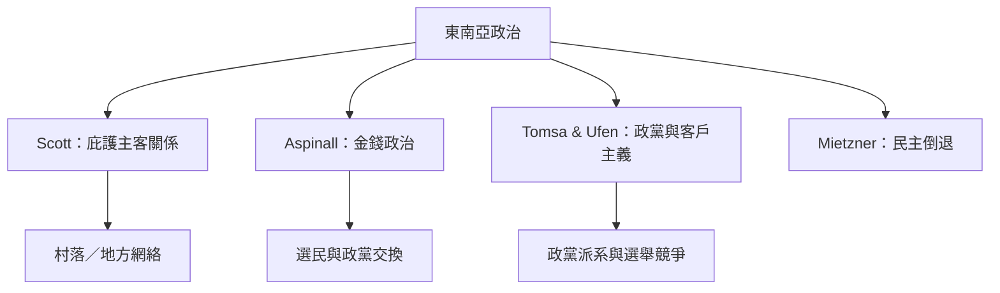

東南亞研究提供從村落庇護關係、政黨組織、金錢政治到民主倒退的不同分析層次。閱讀此索引時要區分個人庇護網絡、政黨內部派系、選舉客戶主義與國家層級的新家產制。

## 關係圖

## 參考
* [[史考特將庇護主客關係視為跨區域的政治交換形式]]
* [[阿斯皮納爾分析東南亞金錢政治如何連結政黨與選民]]
* [[米茨納比較印尼菲律賓與泰國的民主倒退因素]]
* [[政治客戶主義]]
* 本書導讀：[[Patrimonialism]]
