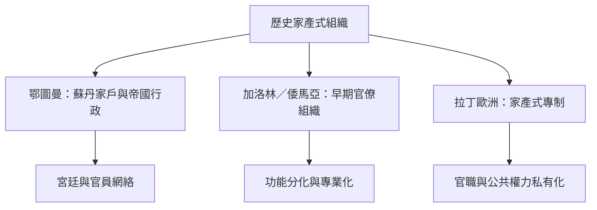

鄂圖曼帝國、加洛林與倭馬亞行政組織，以及拉丁歐洲早期近代國家，提供家戶權威、官職收益、宮廷行政與官僚專業化的歷史比較。它們提醒我們，家產制不是「西方以外」的專屬特徵，也不是歷史發展中必然被官僚制取代的簡單階段。

## 關係圖

## 參考
* [[鄂圖曼帝國的政治組織以擴大的家戶作為重要隱喻]]
* [[埃爾蓋內以鄂圖曼法學菁英討論恩庇與道德界線]]
* [[佩奇比較加洛林與倭馬亞行政體系中的家產式特徵]]
* [[埃特曼以拉丁歐洲早期近代史提出家產式專制概念]]
* [[概念比較必須避免把歐洲歷史當成唯一發展尺度]]
* 本書導讀：[[Patrimonialism]]
