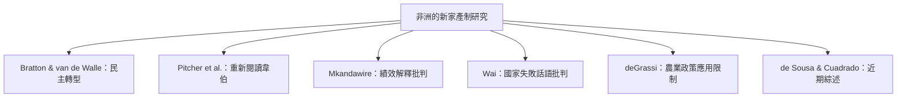

非洲研究是新家產制概念發展的重要場域，但區域內的歷史、制度與政治經濟差異極大。這個索引將經典理論、概念重估、發展績效批判與國家失敗論述批判放在一起，提醒讀者同時閱讀概念的解釋能力與知識政治。

## 關係圖

## 參考
* [[布拉頓與范德瓦勒將新家產制視為非洲政體轉型的制度背景]]
* [[皮徹莫蘭與約翰斯頓提醒韋伯家產制包含統治者與被統治者的互惠]]
* [[姆坎達維雷質疑新家產制對非洲經濟績效的預測力]]
* [[瓦伊批判非洲國家失敗論中的新家產制話語]]
* [[德格拉西檢視新家產制解釋非洲農業停滯的能力與限制]]
* [[德索薩與夸德拉多主張新家產制研究應區分掠奪與發展型態]]
* 本書導讀：[[Patrimonialism]]
