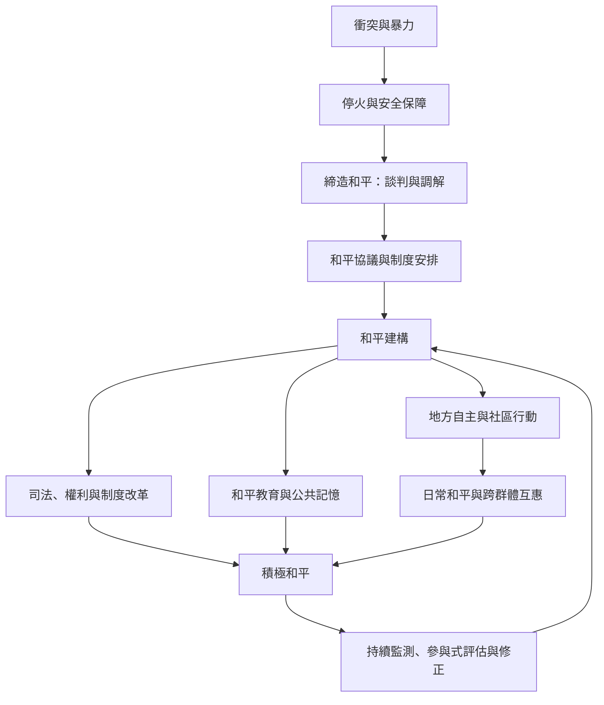

和平建構可以理解為多層次的系統：直接暴力的停止、政治協商、司法與制度改革、地方自主、日常關係和教育文化互相影響。任何單一工具都不足以獨立創造和平；需要在不同層級建立連結，並由受影響者持續檢視成果。

本圖對應[[和平建構]]、[[Peacemaking]]、[[和平維持]]、[[積極和平]]、[[消極和平]]、[[結構性暴力]]、[[地方自主]]與[[日常和平]]。其核心論點是：和平協議不會自行轉化成公平的生活條件，必須結合[[和平協議落實]]與[[參與式評估]]。

## 參考
* [[和平建構必須把停止暴力與改變不公平制度連在一起]]
* [[和平協議只是政治契約而非日常安全的保證]]
* [[有效調解需要同時處理同意公正包容與權力不對等]]
