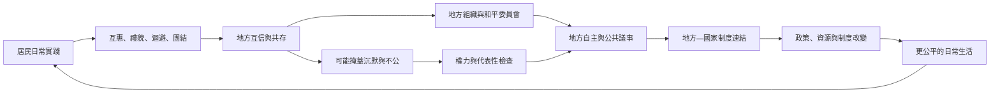

日常和平並非由外部專家製造，而是在居民日常互動、地方組織和公共制度之間逐步形成。地方自主的關鍵不只是「參與」，而是能否影響問題定義、資源與評估。日常和平也可能掩蓋不公，因此需要將共存與權力分析一起進行。

可將[[日常和平]]、[[地方自主]]、[[地方和平委員會]]、[[社會凝聚]]和[[參與式評估]]視為相互支撐的概念。對照肯亞 Wajir 經驗，也要問地方組織如何取得長期資源及問責能力。

## 參考
* [[日常和平揭示一般人如何在分裂社會維持共存]]
* [[肯亞 Wajir 女性和平委員會顯示地方自助組織可擴散為治理網絡]]
* [[地方和平組織需要同時建立互信資源與問責機制]]
