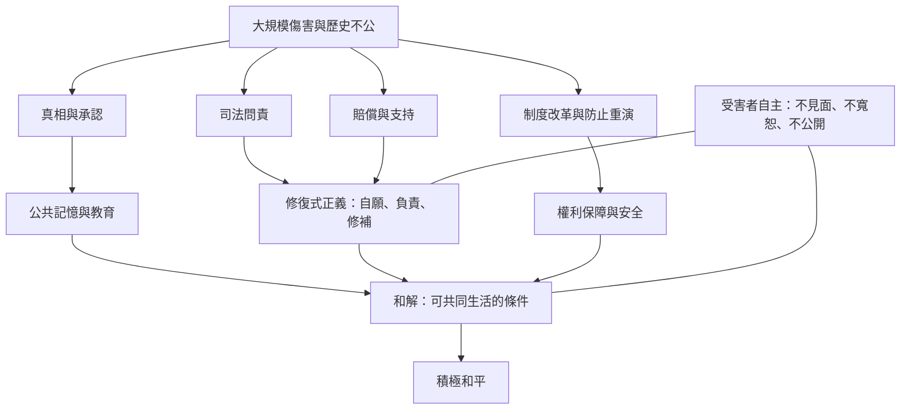

正義與和解不是二選一。真相、問責、賠償、制度改革、紀念、社區修復和日常安全彼此關聯，但不應要求受害者用寬恕交換公共承認。修復式司法可以補充司法系統，卻不能取代程序保障和基本權利。

此圖把[[轉型正義]]、[[修復式正義]]、[[和解]]、[[受害者中心方法]]、[[Ubuntu]]與[[和平教育]]放在同一架構。它強調和解不以個人寬恕為前提，制度責任也不能由受害者承擔。

## 參考
* [[盧安達 Gacaca 顯示社群修復與程序保障之間存在張力]]
* [[紐西蘭修復式司法會議以承擔責任及修補傷害為核心]]
* [[南非真相和解經驗提醒社群倫理不能要求受害者寬恕]]
