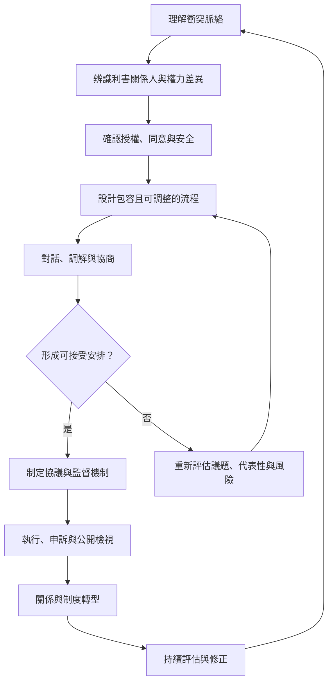

調解是一段有準備、有授權、有風險評估的過程。調解者不應只追求快速達成共識，而要確認參與的正當性、權力差異和後續落實條件。衝突轉型進一步把焦點從協議擴展到關係、結構和敘事。

流程應連結[[調解]]、[[同意]]、[[包容式和平進程]]、[[受害者中心方法]]、[[衝突轉型]]及[[和平協議落實]]。如果協商涉及重大侵害，還需兼顧[[轉型正義]]和[[積極和平]]。

## 參考
* [[聯合國有效調解指引把和平協商視為有準備且包容的過程]]
* [[有效調解需要同時處理同意公正包容與權力不對等]]
* [[和平學習應比較機制而不是複製成功故事]]
