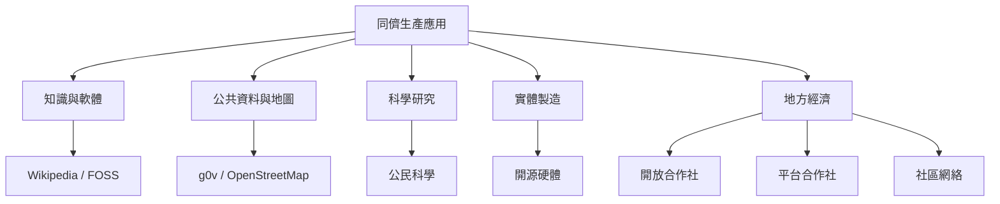

同儕生產不只發生於軟體和百科，也能延伸到公民科技、公共研究、地理資訊、農業硬體、食物系統、通訊網絡和勞工平台。不同領域的關鍵差異在於成果是否可複製、地方知識的比重、物質資源需求與責任風險。

案例入口：[[data/g0v 台灣零時政府以開源協作生產公共工具]]、[[data/2026 尼泊爾女性參與開放地圖支援災害治理]]、[[data/Zooniverse 讓公眾參與專業研究資料的分類與分析]]、[[data/Open Food Network 案例把數位公地連接地方食物系統]]、[[data/Pantazis 與 Meyer 2019 開源農具連結數位公地與實體製造]]、[[data/Grohmann 2022 比較西班牙法國巴西的勞工自有平台]]。
