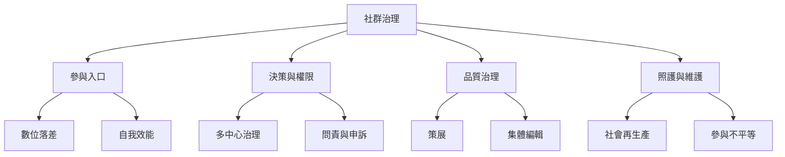

同儕生產的民主潛力取決於參與條件與權力設計，而非「人人可編輯」這句口號。治理包含規則形成、權限制衡、品質審查、策展、衝突解決和照顧維護工作。必須同時考慮 [[參與不平等]]、[[知識正義]]、[[社會再生產]] 和 [[自我效能]]。

本圖導向：[[note/去中心化社群仍需要可問責的治理結構]]、[[note/開放參與不會自動消除權力不平等]]、[[note/開放權利必須搭配可實際進入的參與基礎設施]]、[[note/品質治理需要在中立性與參與成本間取得平衡]]、[[note/照護與性別責任會形塑誰能持續參與]]。
