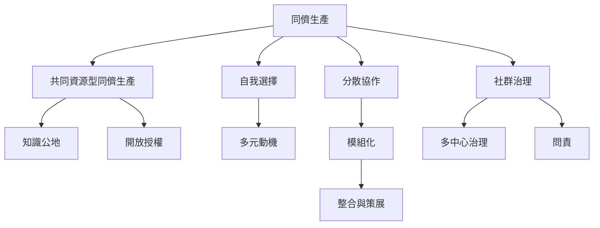

同儕生產可視為市場與企業階層之外的一種協調模式。核心問題包含參與者如何自選任務、共享投入和產出、整合模組，以及如何建立治理制度。它與 [[知識公地]]、[[點對點]]、[[社會生產]] 和 [[開放授權]] 緊密相關。

本圖導向：[[note/同儕生產改變的是協調方式而不只是生產者身分]]、[[note/同儕生產的優勢來自分散知識與自選任務]]、[[note/共同資源讓貢獻能被後來者重用與改良]]、[[note/同儕生產需要模組化任務與低成本整合]]、[[note/同儕生產可以與企業及政府形成混合制度]]。
