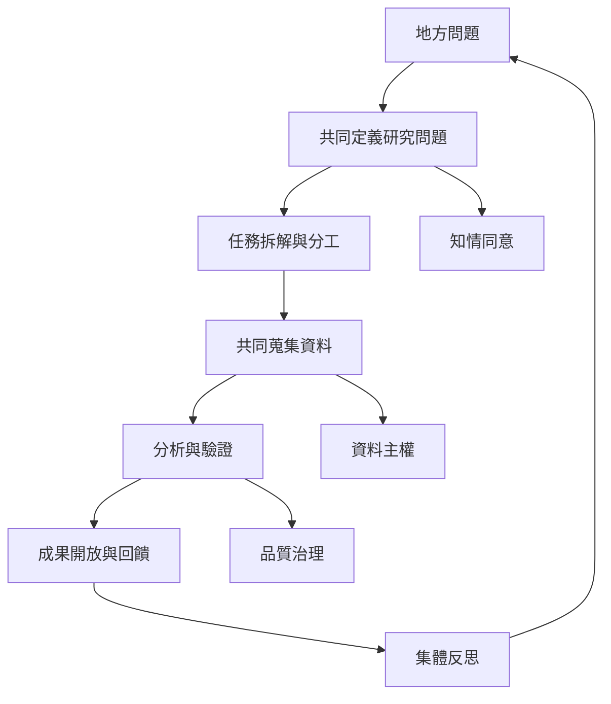

研究與行動可以形成循環：從地方需求出發，共同定義問題，再以模組化任務蒐集資料、製作成果、驗證與修正，最後回饋到社群和制度。[[參與式行動研究]]、[[公民科學]] 與 [[公民科技]] 都能提供方法，但要留意參與者授權、資料風險與知識正義。

本圖導向：[[note/參與式研究讓社群成為知識共同生產者]]、[[note/公民科學需要專業設計與群眾貢獻互補]]、[[idea/用參與式研究整理地方生活中的真實問題]]、[[idea/為公共知識庫建立缺漏地圖而不只累積文章]]。
