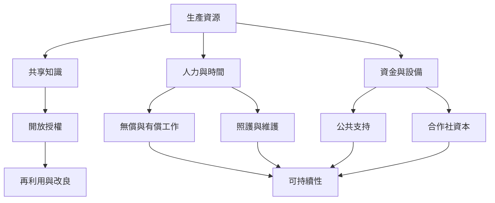

同儕生產的持續性不只取決於理想，也取決於資源、交易成本、工作分配、法律和公共制度。數位資源的複製成本低，但社群維護、品質控制、照顧和實體製造仍需要時間與資金。

本圖導向：[[note/知識公地不會耗竭但社群維護能力仍有限]]、[[note/參與動機多元且會隨生命情境變化]]、[[note/地方食物網絡能把數位公地轉成實體互助基礎設施]]、[[note/平台合作社必須讓工作者掌握平台治理權]]。
