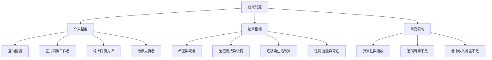

證據地圖需按場域、介入成分與結果指標分類。對心理健康、物質使用、HIV 與數位社群的研究，常見結果並不相同；量化成效不能替代對關係、賦權與制度經驗的理解。

閱讀[[同儕支持的成效必須依目標與場域分開評估]]，並連結[[精神健康同儕支持的統合回顧顯示效果與執行條件高度異質]]、[[2025 年復元支持服務回顧認為同儕支持較能促進治療銜接而非確證戒癮結果]]、[[2026 年物質使用復元支持回顧顯示治療銜接較穩定而過量與死亡證據仍不一致]]與[[2026 年數位同儕支持統合分析發現心理症狀與個人復元有小至中度改善]]。
