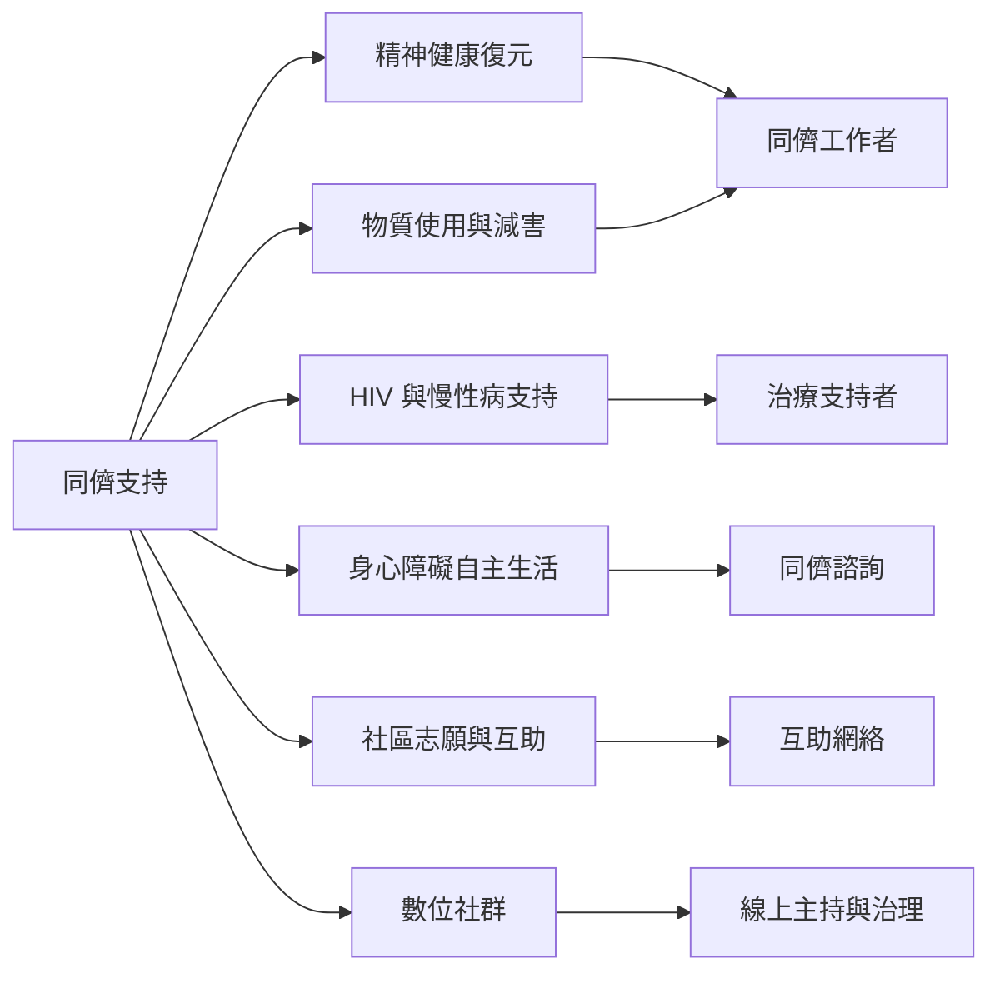

同儕支持不是單一服務，而是在不同社群與制度中形成的多種實踐。精神健康同儕工作、物質使用復元、HIV 治療支持、身心障礙自主生活、社區志願者及數位社群，彼此可以互相學習，但不能忽略各自的權力與責任配置。

可從[[同儕支持的形式必須依場域與關係而調整]]進入，再閱讀[[世界衛生組織的印度案例顯示社區志願者能把心理健康支持帶到日常生活]]、[[撒哈拉以南非洲的 HIV 治療支持研究顯示社區同儕可促進服藥依從]]與[[身心障礙者自主生活運動把同儕諮詢連結到公民權與去機構化]]。
