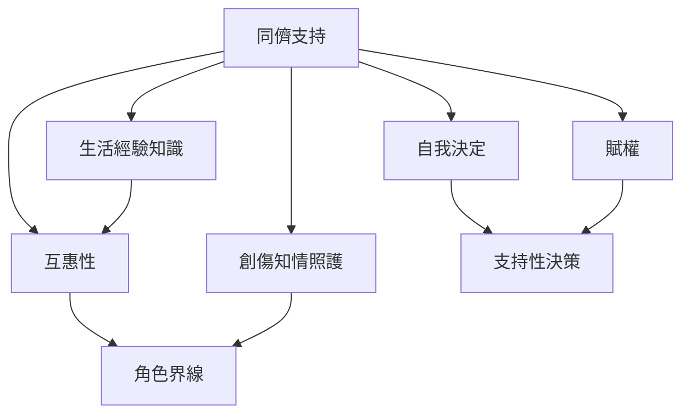

同儕支持的倫理核心，是把共同經驗轉化為互相理解，而不把經驗變成權威。好的支持關係同時需要自我決定、互惠、界線、賦權與創傷知情；其檢核標準不是支持者做了多少事，而是參與者是否能保有主體性與選擇。

這張地圖與[[同儕支持的可信度來自共同經驗而不是專業權威]]、[[互惠關係使支持者與受支持者都保有主體性]]、[[同儕支持必須以自我決定而不是代替決定為目標]]、[[支持者的界線讓關係可以長期持續]]互相連結。概念定義見 [[同儕支持]]、[[生活經驗知識]]、[[互惠性]]、[[自我決定]]、[[賦權]]。
