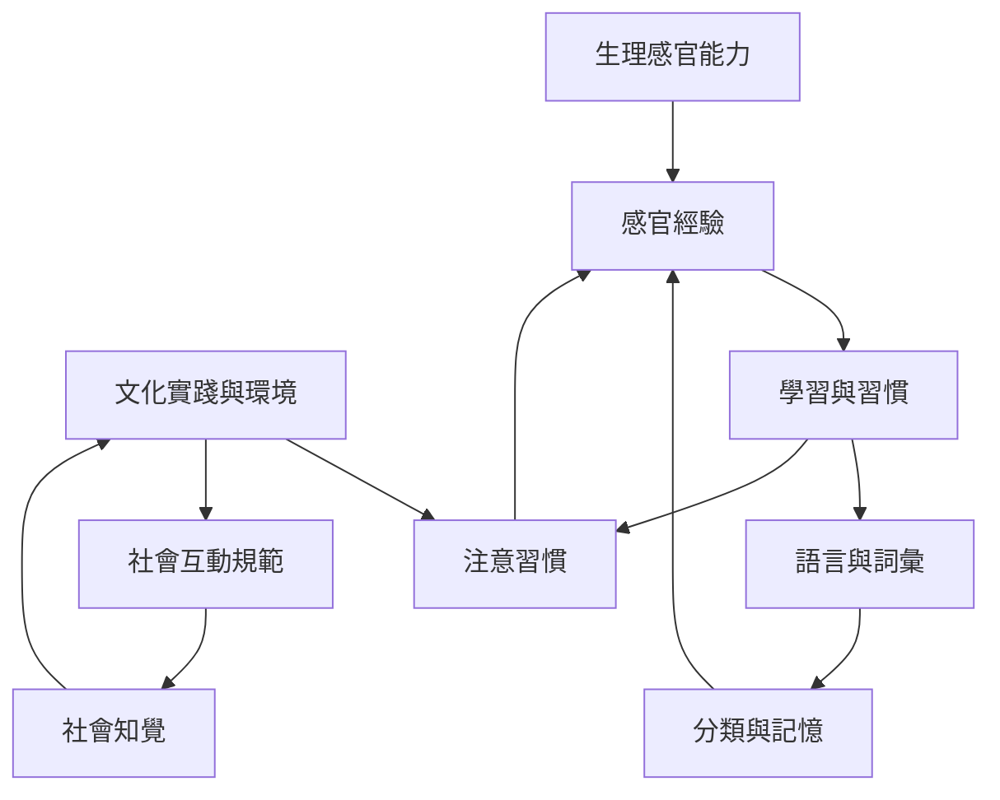

知覺既有生理條件，也在語言、文化、教育、勞動、藝術和人際關係中被學習。跨文化研究顯示，感官詞彙、場景注意、音樂期待與臉孔辨識都可能隨經驗不同而變化；但研究結果並不支持把國家或族群簡化成固定知覺類型。感官民族誌與多地實驗可以互相補足。

## 參考
* [[感官經驗由生理能力與文化實踐共同塑造]]、[[語言提供注意與記憶感官差異的工具]]、[[文化會影響注意分配但不決定每個人的觀看方式]]。
* [[感官是文化實踐而非固定不變的生理清單]]、[[七地眼動研究顯示文化知覺差異不能簡化為東西二分]]、[[Jahai 嗅覺詞彙顯示不同語言能培養不同的感官描述]]、[[顏色分類同時受到視覺共通性與語言差異影響]]。
* 概念：[[文化知覺]]、[[語言相對論]]、[[感官民族誌]]、[[社會知覺]]、[[知覺學習]]、[[多感官整合]]。
